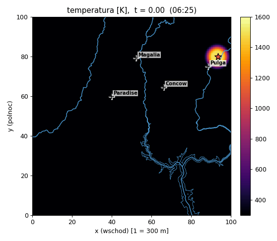
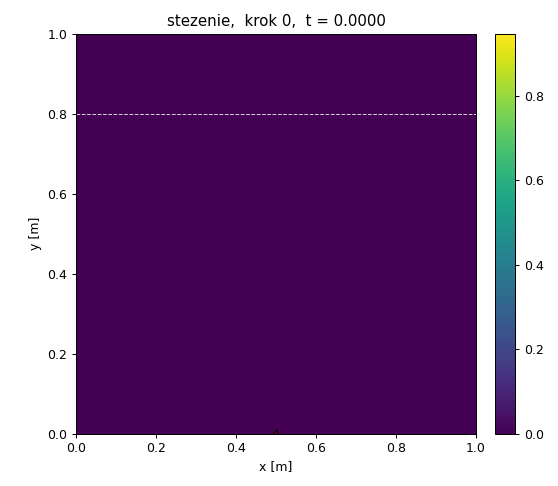

<p align="center">
  <b>Start</b> &nbsp;|&nbsp;
  <a href="wildfire_project/README.md">Pożar lasu</a> &nbsp;|&nbsp;
  <a href="pollution_project/README.md">Zanieczyszczenia</a>
</p>

# Symulacje w IGA-ADS

Projekty z przedmiotu *Algorytmy adaptacyjne* (AGH) w bibliotece
[IGA-ADS](https://github.com/marcinlos/iga-ads). Każdy projekt ma własne README,
między którymi przełączasz się paskiem u góry strony.

| Projekt | Co symuluje | Raport |
|---|---|---|
| [Pożar lasu](wildfire_project/README.md) | Camp Fire 2018 (Kalifornia) na prawdziwych danych: paliwo LANDFIRE, wiatr ze stacji Jarbo Gap, porównanie z obserwacjami NIST | [`raport/raport_overleaf.zip`](raport/raport_overleaf.zip) |
| [Zanieczyszczenia](pollution_project/README.md) | Chmura zanieczyszczeń pod inwersją termiczną i jej usuwanie falą uderzeniową z działka | [`pollution_project/raport/raport_overleaf.zip`](pollution_project/raport/raport_overleaf.zip) |

| Pożar lasu | Zanieczyszczenia |
|---|---|
|  |  |

## Wspólne przygotowanie

Oba projekty liczą się w tym samym kontenerze Dockera `iga-ads-dev`, a obsługuje się je
tak samo przez [`just`](https://github.com/casey/just).

Potrzebne:
- Docker Desktop (uruchomiony),
- `just`,
- Python 3 z `numpy`, `matplotlib` i `pillow` (dla pożaru także `pandas` i `openpyxl`).

**1. Obraz `iga-ads:latest`** (raz):

```bash
git clone https://github.com/marcinlos/iga-ads.git --branch spciaa
cd iga-ads
sed -i '' 's/podman/docker/g' justfile
mv Containerfile Dockerfile
sed -i '' 's/install-dependencies.sh,z/install-dependencies.sh/' Dockerfile
just image
```

Na Linuksie i w WSL zamiast `sed -i ''` wpisz `sed -i`.

**2. Kontener i kompilacja.** W katalogu wybranego projektu:

```bash
just kontener
just rebuild
```

**3. Python z pakietami.** Jeśli pakiety są w innym Pythonie niż `python3` (np. w condzie):

```bash
export PYTHON=/opt/homebrew/Caskroom/miniconda/base/bin/python3
```

## Wspólny schemat pracy

W obu projektach są te same komendy:

| Komenda | Co robi |
|---|---|
| `just run [nazwa=wartość ...]` | Nowy przebieg w folderze `przebiegi/run_<data>_<godzina>/` z `params.csv`. Parametry zmieniasz bez kompilacji. |
| `just gif` | Animacja i klatki PNG ostatniego przebiegu. |
| `just przebiegi` | Tabela wszystkich przebiegów z parametrami. |
| `just rebuild` | Kompilacja po zmianie kodu C++. |
| `just clean` | Usuwa z kontenera dane starych przebiegów. |

## Struktura

```
spcia_agh_course/
├── README.md               ta strona
├── raport/                 raport z pożaru (LaTeX + zip dla Overleafa)
├── wildfire_project/       pożar lasu: kod, dane, narzędzia, przebiegi
└── pollution_project/      zanieczyszczenia: kod, narzędzia, przebiegi, raport
```
