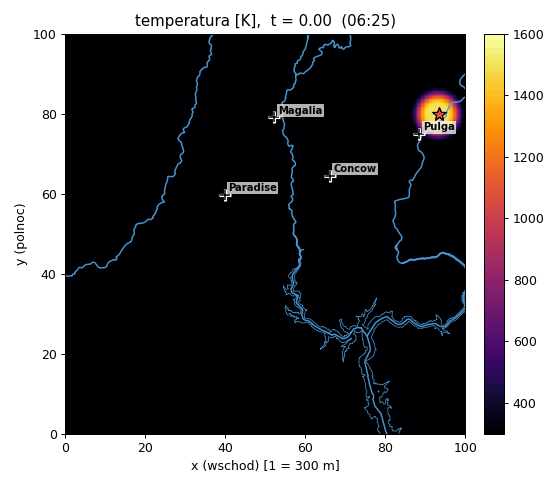
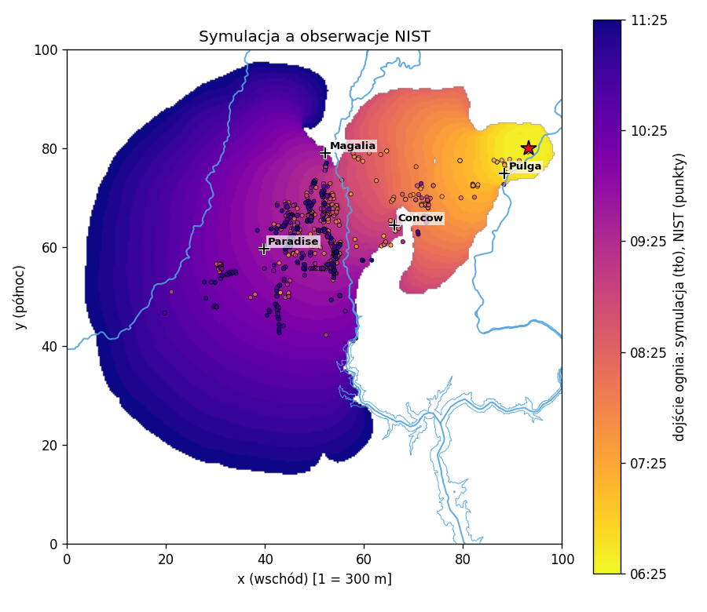

# Camp Fire 2018 w IGA-ADS

Symulacja pożaru lasu **Camp Fire** (Kalifornia, 8 listopada 2018) modelem z zajęć
(Grasso & Innocente) w bibliotece [IGA-ADS](https://github.com/marcinlos/iga-ads).
Mapa paliwa, wiatr i miejsce zapłonu pochodzą z prawdziwych pomiarów. Wynik jest porównywany
z obserwacjami ognia z raportu NIST.

| Temperatura | Symulacja a obserwacje NIST |
|---|---|
|  |  |

- Obszar: kwadrat 30 × 30 km wokół miejsca zapłonu. W modelu to `[0, 100]²`, więc 1 jednostka = 300 m.
  x rośnie na wschód, y na północ.
- Czas: od 6:25 do 11:25. W modelu to `t ∈ [0, 10]`, więc 1 jednostka czasu = 30 min.
- Paliwo: LANDFIRE 2016 (stan sprzed pożaru) i rzeki z OpenStreetMap.
- Wiatr: stacja pogodowa Jarbo Gap, pomiary co godzinę. Wieje z północnego wschodu.
- Zapłon: pierwsza obserwacja NIST, przy linii energetycznej koło Pulga.

## Spis treści

1. [Instalacja](#instalacja)
2. [Szybki start](#szybki-start)
3. [Komendy](#komendy)
4. [Parametry symulacji](#parametry-symulacji)
5. [Co zmieniliśmy w modelu](#co-zmieniliśmy-w-modelu)
6. [Struktura plików](#struktura-plików)
7. [Źródła danych](#źródła-danych)
8. [Gdzie co jest do raportu](#gdzie-co-jest-do-raportu)

## Instalacja

Potrzebne:
- [Docker Desktop](https://www.docker.com/products/docker-desktop/) (uruchomiony),
- [`just`](https://github.com/casey/just),
- Python 3 z `numpy`, `matplotlib`, `pillow`, `pandas` i `openpyxl` (np. z condy).

```bash
brew install just
```

**1. Obraz Dockera z IGA-ADS** (raz). Kod biblioteki z przykładem `fire` pochodzi z gałęzi
`spciaa`:

```bash
git clone https://github.com/marcinlos/iga-ads.git --branch spciaa
cd iga-ads
sed -i '' 's/podman/docker/g' justfile
mv Containerfile Dockerfile
sed -i '' 's/install-dependencies.sh,z/install-dependencies.sh/' Dockerfile
just image
```

**2. Kontener roboczy** (raz). Wszystkie komendy poniżej uruchamiaj z katalogu `wildfire_project`:

```bash
cd wildfire_project
just kontener
just rebuild
```

`just kontener` zakłada kontener `iga-ads-dev`, który działa w tle. Pierwsze `just rebuild`
kompiluje całą bibliotekę, więc trwa kilka minut. Każde następne kompiluje tylko `fire` (ok. 30 s).

**3. Python.** `just gif` i `just porownaj` uruchamiają `python3`. Jeśli pakiety są w innym
Pythonie (np. w condzie), wskaż go raz w `~/.zshrc`:

```bash
export PYTHON=/opt/homebrew/Caskroom/miniconda/base/bin/python3
```

## Szybki start

```bash
cd wildfire_project
just run
just gif
just porownaj
```

`just run` liczy symulację w kontenerze (ok. 45 s). `just gif` składa animacje w `anim/`,
a `just porownaj` porównuje wynik z NIST.

Przykład próby z innymi parametrami (bez kompilacji):

```bash
just run TU=0.6 cw=1.0
just porownaj
```

## Komendy

Wszystkie z katalogu `wildfire_project`. `just` bez argumentów wypisuje listę.

| Komenda | Co robi |
|---|---|
| `just kontener` | Zakłada kontener `iga-ads-dev` z obrazu `iga-ads:latest` i konfiguruje CMake. Robisz to raz. |
| `just rebuild` | Kopiuje `fire.cpp`, `fire.hpp` i `camp_fire_data.hpp` do kontenera i kompiluje. Potrzebne po zmianie kodu C++ albo po `just dane`. |
| `just run [nazwa=wartość ...]` | Usuwa stare wyniki i liczy symulację w `/tmp/wildfire` w kontenerze. Wypisuje czas i użyte parametry, które zapisuje też w `params.txt`. |
| `just gif` | Tworzy `anim/fire.gif`, `anim/fuel.gif`, `anim/wind.gif` i klatki PNG w `anim/png/`, z rzekami, miejscowościami i godziną. |
| `just porownaj` | Porównuje ostatni przebieg z obserwacjami NIST: wypisuje wskaźniki i rysuje `anim/porownanie_nist.png`. |
| `just dane` | Przelicza dane z `dane_nist/` na `camp_fire_data.hpp`, `model_data.json` i `model_paliwo.png`. Potrzebne tylko przy zmianie danych albo szerokości pasa rzek. Potem `just rebuild`. |
| `just clean` | Usuwa `/tmp/wildfire` w kontenerze. |
| `just n=60 run` | Inna siatka (domyślnie `n=80`, `p=2`). Uwaga: rzadsza siatka zmienia wynik. |

Pliki `.data` (temperatura `out_*.data` i paliwo `fuel_*.data`) zostają w kontenerze.
`gif` i `porownaj` czytają je stamtąd przez `docker exec`.

### Co wypisuje `just porownaj`

```
trafione:     99.7%            obserwacje NIST, do których ogień w symulacji w ogóle doszedł
na czas:      67.0%            ... i to nie później niż 30 min po obserwacji
opóźnienie:  mediana +2 min    symulacja minus NIST (ujemne = symulacja szybsza)
spalone:      48.6%            jaka część palnego obszaru spłonęła do końca przebiegu
poza NIST:    60.9%            jaka część spalonego leży dalej niż 1,5 km od obserwacji NIST
miejscowości (symulacja / NIST):
  Concow    08:10 / 07:24
```

Obserwacje NIST pochodzą głównie z okolic domów i dróg, więc „poza NIST” to raczej wskazówka
niż błąd modelu.

## Parametry symulacji

Wszystkie są w jednym miejscu: `struct fire_params` na początku
[`wildfire_project/fire.hpp`](wildfire_project/fire.hpp). Wartości tam wpisane to ustawienia
domyślne. Każdy parametr można nadpisać w `just run nazwa=wartość` bez kompilacji.

**Fizyka**

| Nazwa | Domyślnie | Co robi |
|---|---|---|
| `rad` | 0.16 | Promieniowanie. Rozchodzi ogień na boki i pod wiatr. Prędkość frontu rośnie jak √`rad`. |
| `loss` | 9 | Straty ciepła w górę. Mniejsza wartość = większe straty. |
| `heat` | 1/6 | Mnożnik ciepła spalania. |
| `burn` | 50 | Tempo wypalania paliwa. |
| `cw` | 0.5 | Jak mocno wiatr niesie ciepło. |
| `Tig` | 800 | Temperatura zapłonu [K]. |
| `fuel_min` | 0.2 | Od ilu paliwa komórka się pali. |
| `fuel_heat` | 1 | 1 = ciepło spalania razy waga klasy paliwa, 0 = jak na slajdach. |

**Wagi paliwa** dla klas LANDFIRE (0–1):

| Nazwa | Domyślnie | Klasa |
|---|---|---|
| `SH` | 1.0 | krzewy (chaparral) |
| `GS` | 1.0 | trawy z krzewami |
| `GR` | 0.8 | trawy |
| `TU` | 0.5 | podszyt leśny |
| `TL` | 0.9 | ściółka leśna |
| `SB` | 1.0 | pozostałości po wycince |
| `urban` | 0.9 | zabudowa |
| `agri` | 0.15 | pola uprawne |
| `rock` | 0.05 | skały, piach |
| `water` | 0 | woda |
| `snow` | 0 | śnieg, lód |
| `other` | 0.5 | kody spoza listy |
| `river` | 0.55 | pas 150 m przy rzece: brana jest mniejsza z wag `river` i klasy |

**Przebieg**

| Nazwa | Domyślnie | Co robi |
|---|---|---|
| `t_end` | 10 | Do której chwili liczyć. 10 = 11:25, 4 = 8:25 (szybki test). |
| `out_every` | 250 | Co ile kroków zapisywać pliki `.data`. 250 daje ok. 40 klatek. |
| `dt` | 0.001 | Krok czasu. Większy zmienia wynik, lepiej nie ruszać. |

## Co zmieniliśmy w modelu

Bazą jest przykład `fire` z IGA-ADS (gałąź `spciaa`), czyli równania ze slajdów. Zmiany:

- `init_state`: gorący punkt (do 1500 K, promień ok. 2 km) w miejscu pierwszej obserwacji NIST.
- `fuel_map`: waga klasy LANDFIRE w danym punkcie, z interpolacją dwuliniową. Mapa klas jest
  w `camp_fire_data.hpp`, a wagi w `fire_params`.
- `wind_velocity`: wiatr z Jarbo Gap interpolowany liniowo w czasie, taki sam w całym obszarze
  (jest tylko jedna stacja). Przelicznik: 0,85 jednostki modelu na 1 m/s.
- **Siła spalania zależna od paliwa** (`fuel_heat = 1`). Na slajdach każda komórka z paliwem
  > 0.2 grzeje tak samo, a ilość paliwa wpływa tylko na to, jak długo się pali. Tutaj ciepło
  spalania jest mnożone przez wagę klasy, więc krzewy grzeją mocniej niż podszyt.
- **Szerszy front ognia.** Przy stałych ze slajdów front ma ok. 0,3–0,4 jednostki szerokości,
  a element siatki 1,25. Ogień wtedy „zacina się” na liniach siatki: idzie wzdłuż osi albo gaśnie.
  Dlatego `rad` i `loss` są pomnożone przez 6, a `heat` i `burn` podzielone przez 6 (względem
  0.035, 1.5, 1 i 300). Lokalnie spalanie trwa 6 razy dłużej, ale progi zapłonu i gaśnięcia
  są te same, a front jest ok. 6 razy szerszy. Dla mnożnika 3 i 6 wyniki są zbliżone.
- Parametry przekazywane z linii poleceń (`fire <N> <p> <wątki> [nazwa=wartość ...]`).
  Zapis wyników jest co 250 kroków zamiast co 10 (wcześniej ok. 10 GB na przebieg).
- `T = max(u, 0)` w `compute_rhs` chroni przed ujemną temperaturą od oscylacji splajnów.
  Bez tego potęgi i `exp` dają NaN w całym polu.

Wagi dobrane porównaniem z NIST. Podszyt (TU) zajmuje 29% obszaru, ale ma tylko 5% obserwacji
ognia, więc ma wagę poniżej progu samodzielnego palenia (ok. 0.55). Ogień przechodzi przez
niego tylko obok traw i krzewów. Ściółka sosnowa (TL) na grzbiecie Paradise ma 45% obserwacji.

**Czego model nie ma:**
- **Przenoszenia ognia przez żar niesiony wiatrem.** Tak Camp Fire przeskakiwał kaniony.
  Dlatego rzeki mają wagę 0.55, a nie 0, a do Concow i Magalii ogień dochodzi ok. 45 min za późno.
- **Rzeźby terenu.**
- **Wiatru zmiennego w przestrzeni.**

## Struktura plików

```
spcia_agh_course/
├── README.md
└── wildfire_project/
    ├── justfile               komendy (just --list)
    │
    ├── fire.hpp               model: fire_params (wszystkie parametry i wagi), init_state,
    │                          fuel_map, wind_velocity, compute_rhs
    ├── fire.cpp               main: czyta nazwa=wartość, zapisuje params.txt, uruchamia symulację
    ├── camp_fire_data.hpp     WYGENEROWANY (just dane): mapa klas paliwa 201×201, tabela wiatru,
    │                          punkt zapłonu; nie edytować ręcznie
    │
    ├── przygotuj_model.py     dane z dane_nist/ → camp_fire_data.hpp, model_data.json,
    │                          model_paliwo.png; tu skala obszaru i czasu, WIND_SCALE, szerokość rzek
    ├── model_data.json        WYGENEROWANY: rzeki, jezioro, miejscowości, wiatr (dla animate.py)
    ├── model_paliwo.png       WYGENEROWANY: podgląd mapy klas paliwa
    │
    ├── animate.py             .data z kontenera → anim/fire.gif, fuel.gif, wind.gif, anim/png/
    ├── porownaj_nist.py       porównanie przebiegu z NIST → wskaźniki, anim/porownanie_nist.png
    ├── anim/                  wyniki just gif i just porownaj
    │
    └── dane_nist/             prawdziwe dane o pożarze i skrypty do nich (opis: dane_nist/README.md)
        ├── NIST TN 2135 Appendix F Fire Spread Data.xlsx   obserwacje ognia (czas + GPS)
        ├── osm_woda.json      rzeki i jezioro Oroville z OpenStreetMap
        ├── woda.overpassql    zapytanie Overpass, którym pobrano osm_woda.json
        ├── jarbo_gap.csv      wiatr ze stacji RAWS Jarbo Gap (7–10 XI 2018)
        ├── nist_viz.py        mapa i animacja przebiegu pożaru z NIST
        ├── wiatr_jarbo.py     wykres wiatru, tabela godzinowa w m/s
        ├── wiatr_anim.py      animacja wiatru na mapie z rzekami, miejscowościami i ogniem NIST
        ├── landfire_clip.py   wycięcie obszaru pożaru z mapy LANDFIRE dla całych USA
        └── wyniki/            wyniki tych skryptów (mapy, animacje, wycinek LANDFIRE .npz/.tif)
```

**Skąd biorą się dane w symulacji:**

```
dane_nist/ (NIST, OSM, Jarbo Gap, LANDFIRE)
   └─ just dane ──→ camp_fire_data.hpp ─ just rebuild ─→ fire (w kontenerze)
                └─→ model_data.json                        └─ just run ─→ /tmp/wildfire/*.data
                                                                 ├─ just gif ──────→ anim/*.gif
                                                                 └─ just porownaj ─→ anim/porownanie_nist.png
```

## Źródła danych

| Dane | Źródło | Użycie |
|---|---|---|
| Przebieg pożaru | Maranghides i in., *A Case Study of the Camp Fire – Fire Progression Timeline*, NIST Technical Note 2135 (2021), Appendix F *Fire Spread Data*: [data.nist.gov/od/id/mds2-2954](https://data.nist.gov/od/id/mds2-2954) | zapłon, porównanie, mapy NIST |
| Paliwo | LANDFIRE 2016 Remap, FBFM40 (40 modeli paliwa Scotta i Burgana), USGS/USFS: [landfire.gov](https://www.landfire.gov/data) | `fuel_map` |
| Rzeki, jezioro | © współtwórcy [OpenStreetMap](https://www.openstreetmap.org/copyright), licencja ODbL, przez [Overpass API](https://overpass-api.de/) | pas rzek w `fuel_map`, mapy |
| Wiatr | Stacja RAWS Jarbo Gap (JBGC1), archiwum [Iowa Environmental Mesonet](https://mesonet.agron.iastate.edu/) (sieć CA_DCP) | `wind_velocity` |
| Model | model Grasso i Innocente ze slajdów do zajęć, biblioteka [IGA-ADS](https://github.com/marcinlos/iga-ads) (M. Łoś) | równania w `compute_rhs` |

Komendy do pobrania każdego z tych plików są w [`dane_nist/README.md`](wildfire_project/dane_nist/README.md).
Duży plik LANDFIRE (3,1 GB) nie jest w repo, jest tylko wycinek w `dane_nist/wyniki/`.

Uwagi:
- W pliku NIST rok jest wpisany jako 2021. Skrypty poprawiają go na 2018.
- Czas w danych IEM jest w UTC. Skrypty przeliczają go na czas lokalny PST (UTC − 8 h).

## Gdzie co jest do raportu

| Punkt | Plik |
|---|---|
| Zmieniony kod | `wildfire_project/fire.hpp`, `wildfire_project/fire.cpp` |
| Opis pożaru | `dane_nist/wyniki/mapa_obserwacje.png`, `pozar_nist.gif`, `odleglosc_czas.png`, `rejony_czas.png` |
| Mapa paliwa | `model_paliwo.png` (klasy), `anim/png/fuel/fuel_00000.png` (wagi w modelu), `dane_nist/wyniki/landfire_paliwo.png` |
| Stan początkowy | `anim/png/fire/fire_00000.png` |
| Wiatr w różnych chwilach | `anim/png/wind/`, `dane_nist/wyniki/wiatr_jarbo.png`, `dane_nist/wyniki/klatki_wiatr/` |
| Animacja wiatru | `anim/wind.gif`, `dane_nist/wyniki/wiatr_anim.gif` |
| Animacja pożaru | `anim/fire.gif`, `anim/fuel.gif` |
| Kroki czasowe PNG | `anim/png/fire/`, `anim/png/fuel/` |
| Porównanie z prawdziwym pożarem | `anim/porownanie_nist.png` i wynik `just porownaj` |
