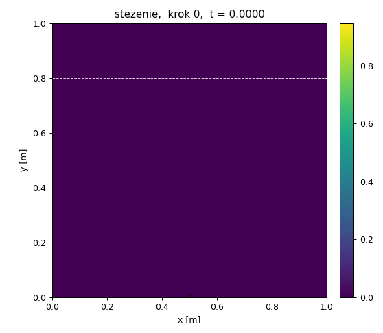

<p align="center">
  <a href="../README.md">Start</a> &nbsp;|&nbsp;
  <a href="../wildfire_project/README.md">Pożar lasu</a> &nbsp;|&nbsp;
  <b>Zanieczyszczenia</b>
</p>

# Usuwanie zanieczyszczeń falą uderzeniową

Chmura pary wodnej z cząstkami zanieczyszczeń unosi się znad ziemi i zatrzymuje pod warstwą
inwersji termicznej. Działko generujące fale uderzeniowe przebija inwersję i wypycha
zanieczyszczenie w górę. Model z zajęć (Misan i in., ICCS 2022) w 2D w bibliotece
[IGA-ADS](https://github.com/marcinlos/iga-ads).



## Spis treści

1. [Szybki start](#szybki-start)
2. [Model](#model)
3. [Działko](#działko)
4. [Parametry](#parametry)
5. [Komendy](#komendy)
6. [Wyniki](#wyniki)
7. [Struktura plików](#struktura-plików)

## Szybki start

Instalacja obrazu Dockera jest opisana na [stronie startowej](../README.md#wspólne-przygotowanie).
Komendy uruchamiaj z katalogu `pollution_project`:

```bash
just kontener
just rebuild
just run
just gif
```

`just run` liczy przebieg (ok. 1,5 min), a `just gif` robi animację w `przebiegi/run_.../`.

Porównanie z wariantem bez działka:

```bash
just run cannon_amp=0
just przebiegi
just masa run_<z działkiem> run_<bez działka>
```

## Model

Pole $u(x, y, t)$ to stężenie na kwadracie $[0, 1]^2$ ($y$ to wysokość):

$$
\frac{\partial u}{\partial t} + \Big(\frac{\partial T}{\partial y} + \mathrm{cannon}(x, y, t)\Big)\frac{\partial u}{\partial y}
- K_x \frac{\partial^2 u}{\partial x^2} - K_y \frac{\partial^2 u}{\partial y^2} = f(y, t)
$$

- **Inwersja:** $\partial T/\partial y = -5{,}2$ dla $y < 0{,}8$ i $0$ powyżej. Nad $y = 0{,}8$ chmura przestaje się unosić.
- **Dyfuzja:** $K_x = 1$, $K_y = 0{,}1$.
- **Źródło przy ziemi:** $f = (150 - 1200y)\,s(t)$ dla $y \le 0{,}125$. Czynnik $s(t)$ włącza je dla
  $t < 0{,}025$ i ponownie dla $t \in [0{,}175;\,0{,}225]$.
- **Brzegi:** na dole $u = 0$ (od ziemi napływa czyste powietrze), na górze i po bokach $\nabla u \cdot n = 0$.
- **Siatka i czas:** $40 \times 40$ elementów, splajny stopnia 2, jawny Euler, $\Delta t = 10^{-5}$, 30 000 kroków.

## Działko

$$
\mathrm{cannon}(x, y, t) = -A \sum_{k=1}^{n} \exp\Big(-\frac{(x - x_k)^2}{w^2}\Big)\, e^{-y/L}\,
\sin\Big(\pi \frac{\varphi}{\tau}\Big), \qquad \varphi = (t - t_0) \bmod P
$$

dla $t \ge t_0$ i $\varphi < \tau$, a poza tym 0.

- **Impulsy.** Strzał trwa $\tau = 0{,}03$ i powtarza się co $P = 0{,}06$, jak wybuchy w generatorze fali uderzeniowej.
- **Kolumna.** Działko działa w wąskim pasie wokół $x_k$ (szerokość $w = 0{,}08$).
  Domyślnie jest jedno ($n = 1$, $x_1 = 0{,}5$); `cannon_n=3` dodaje kolejne co `cannon_dx`.
- **Zasięg.** Siła maleje z wysokością ($L = 1$).
- **Pierwszy strzał** w $t_0 = 0{,}16$, gdy chmura stoi już pod inwersją. Wcześniejsze strzelanie
  usuwa mniej (patrz [Wyniki](#wyniki)).

Kod: `cannon()` w [`pollution.hpp`](pollution.hpp), wynik jest dodawany do `dTy` w `compute_rhs`.

## Parametry

Bez kompilacji, np. `just run cannon_n=1 cannon_amp=120`:

| Nazwa | Domyślnie | Co robi |
|---|---|---|
| `cannon_t` | 0.07 | chwila pierwszego strzału (krok = t / 10⁻⁵) |
| `cannon_amp` | 80 | siła (0 wyłącza działka) |
| `cannon_x` | 0.5 | środek układu działek |
| `cannon_n` | 1 | liczba działek |
| `cannon_dx` | 0.3 | odstęp między działkami |
| `cannon_shots` | 2 | liczba strzałów (po 0,03, co 0,06) |

Siatki nie zmieniaj: krok czasu $10^{-5}$ jest dobrany do $40 \times 40$.

## Komendy

| Komenda | Co robi |
|---|---|
| `just kontener` | Uruchamia kontener `iga-ads-dev` albo zakłada go z obrazu `iga-ads:latest`. |
| `just rebuild` | Kopiuje `pollution.cpp` i `pollution.hpp` do kontenera i kompiluje. |
| `just run [nazwa=wartość ...]` | Nowy przebieg `przebiegi/run_<data>_<godzina>/` z `params.csv` i `log.txt`, wiersz w `przebiegi.csv`. |
| `just gif [run] [opcje]` | `pollution.gif` i klatki PNG. Opcje: `--log` (skala logarytmiczna), `--vmax`, `--frames`. |
| `python3 analiza.py bez=run_A emisja=run_B ...` | Wszystkie wykresy i liczby do raportu: działko w przestrzeni i czasie, wznoszenie chmury, miary, bilans masy. |
| `just masa run_A run_B ...` | Ilość zanieczyszczenia przy ziemi i pod inwersją w czasie: `przebiegi/masa/masa.png` i `masa.csv`. |
| `just przebiegi` | Tabela wszystkich przebiegów. |
| `just shell` | Powłoka w kontenerze w katalogu ostatniego przebiegu. |
| `just clean` | Usuwa z kontenera dane wszystkich przebiegów poza ostatnim. |

## Wyniki

Eksperyment: te same 2 strzały, różny tylko początek strzelania (szczegóły w raporcie).

| Start strzelania | Stężenie przy ziemi, średnio | Pod inwersją, średnio | Pod inwersją na końcu |
|---|---|---|---|
| bez działka | 0,139 | 0,134 | 0,214 |
| w czasie emisji ($t = 0{,}005$) | **0,128** | **0,117** | 0,214 |
| w trakcie wznoszenia ($t = 0{,}07$) | 0,139 | 0,124 | 0,214 |
| po uformowaniu ($t = 0{,}16$) | 0,132 | 0,122 | **0,149** |

Odpowiedź jest warunkowa. Dla ludzi przy ziemi i dla pierwszej chmury nie warto czekać.
Na stan końcowy wpływa tylko start po uformowaniu, bo jego strzały trafiają w drugą emisję.

Bilans masy zamyka się z dokładnością ok. 1,5%: emisja minus osiadanie na ziemi minus ubytek na inwersji.
Ten ostatni wynika z niezachowawczej postaci adwekcji w równaniu z zajęć.
Raport: [`raport/raport_overleaf.zip`](raport/raport_overleaf.zip).

## Struktura plików

```
pollution_project/
├── justfile         komendy (just --list)
├── pollution.hpp    model: źródło, inwersja, cannon(), compute_rhs
├── pollution.cpp    main: parametry z linii poleceń, params.csv
├── animate.py       .data z kontenera → pollution.gif, png/
├── masa.py          ilość zanieczyszczenia w warstwach dla kilku przebiegów
├── analiza.py       wykresy i liczby do raportu
├── anim/            animacja pokazywana w tym README
├── przebiegi/       kolejne przebiegi i przebiegi.csv
└── raport/          raport LaTeX + zip dla Overleafa
```
